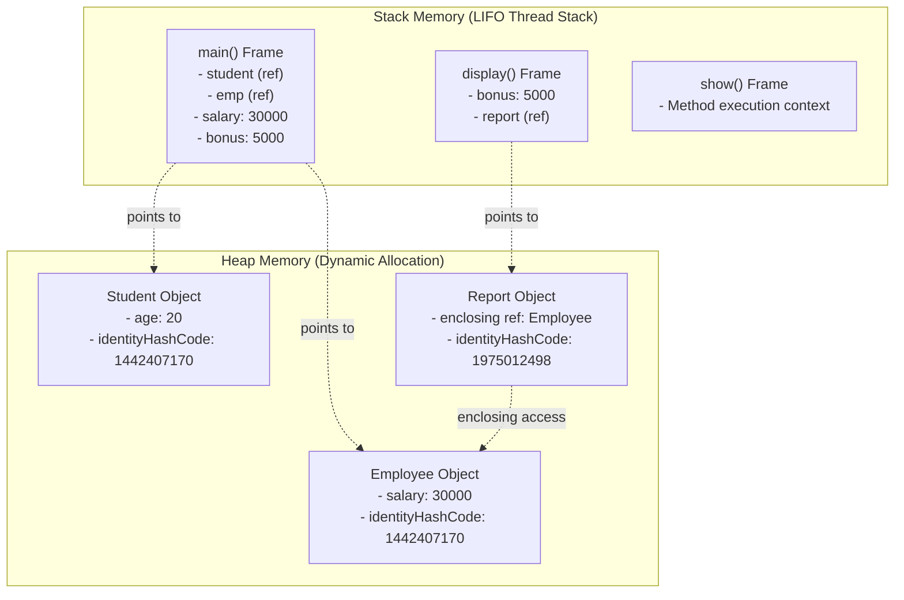

# Java Memory Management Lab: Stack vs Heap Memory Demonstration

This repository contains practical implementations and comprehensive documentation for understanding **Java Memory Architecture**, specifically focusing on **Stack Memory**, **Heap Memory**, **Stack Frames (Method Call Stack)**, and **Local Inner Classes**.

---

## 📋 Table of Contents
1. [Overview of Java Memory Architecture](#-overview-of-java-memory-architecture)
2. [Problem 1: Student Class (Stack vs Heap Demonstration)](#-problem-1-student-class-stack-vs-heap-demonstration)
   - [Problem Statement](#problem-statement-1)
   - [Code Implementation](#code-implementation-1)
   - [Memory Allocation Breakdown](#memory-allocation-breakdown-1)
   - [Sample Execution & Output](#sample-execution--output-1)
3. [Problem 2: Employee Class (Stack Frames, Heap Objects & Local Inner Classes)](#-problem-2-employee-class-stack-frames-heap-objects--local-inner-classes)
   - [Problem Statement](#problem-statement-2)
   - [Code Implementation](#code-implementation-2)
   - [Stack Frame Lifecycle & Execution Trace](#stack-frame-lifecycle--execution-trace)
   - [Sample Execution & Output](#sample-execution--output-2)
4. [In-Depth Concept Analysis](#-in-depth-concept-analysis)
   - [Stack vs Heap Comparison Table](#stack-vs-heap-comparison-table)
   - [Role of System.identityHashCode()](#role-of-systemidentityhashcode)
5. [How to Compile and Run](#-how-to-compile-and-run)

---

## 🧠 Overview of Java Memory Architecture

In the Java Virtual Machine (JVM), runtime data is organized into distinct memory areas:

```
+-----------------------------------------------------------------------+
|                              JVM MEMORY                               |
+------------------------------------+----------------------------------+
|            STACK MEMORY            |           HEAP MEMORY            |
|  (Thread-specific, LIFO frames)    |   (Shared across all threads)    |
+------------------------------------+----------------------------------+
|  - Primitive local variables       |  - All objects (instances)       |
|  - Reference variables (pointers)  |  - Instance variables/fields     |
|  - Method invocation frames        |  - Managed by Garbage Collector  |
+------------------------------------+----------------------------------+
```



---

## 📌 Problem 1: Student Class (Stack vs Heap Demonstration)

### Problem Statement 1
Write a Java program that creates a `Student` class with:
- An instance variable `age`.
- A method `display()`.
- Inside `display()`, declare a local variable `marks`.
- Create a `Student` object in `main()` and display:
  1. The instance variable (`age`).
  2. The local variable (`marks`).
  3. The object identity using `System.identityHashCode()`.

### Code Implementation 1: `Student.java`
The program allows interactive console inputs as well as fallback to sample defaults (`Age: 20`, `Marks: 85`):

```java
import java.util.Scanner;

public class Student {
    // Instance variable -> Allocated in Heap memory as part of Student object
    private int age;

    public Student(int age) {
        this.age = age;
    }

    public Student() {
        this.age = 20;
    }

    public void display() {
        int marks = 85; // Local variable -> Allocated in display()'s Stack frame
        printDetails(marks);
    }

    public void display(int inputMarks) {
        int marks = inputMarks; // Local variable in current Stack frame
        printDetails(marks);
    }

    private void printDetails(int marks) {
        System.out.println("Instance Variable (age): " + this.age);
        System.out.println("Local Variable (marks): " + marks);
    }

    public static void main(String[] args) {
        int inputAge = 20;
        int inputMarks = 85;

        Scanner scanner = new Scanner(System.in);
        try {
            System.out.print("Age: ");
            if (scanner.hasNextInt()) inputAge = scanner.nextInt();
            System.out.print("Marks: ");
            if (scanner.hasNextInt()) inputMarks = scanner.nextInt();
        } catch (Exception e) {
            inputAge = 20;
            inputMarks = 85;
        }

        // 'student' reference variable is in Stack; 'new Student(...)' object is in Heap
        Student student = new Student(inputAge);

        System.out.println("\nStudent Object Created");
        System.out.println("Object Identity Hash Code: " + System.identityHashCode(student));

        student.display(inputMarks);
        scanner.close();
    }
}
```

### Memory Allocation Breakdown 1

| Element | Kind / Type | Memory Location | Description |
| :--- | :--- | :--- | :--- |
| `student` | Reference Variable | **Stack Memory** | Stored in `main()`'s stack frame; contains memory reference pointing to the Heap object. |
| `Student` Object | Object Instance | **Heap Memory** | Dynamically allocated at runtime via the `new` operator. |
| `age` | Instance Variable | **Heap Memory** | Resides inside the `Student` object on the Heap. Lifetime is tied to the object. |
| `marks` | Primitive Local Variable | **Stack Memory** | Allocated inside `display()`'s stack frame. Deallocated automatically when `display()` finishes. |
| `System.identityHashCode()` | Integer Method Return | **Stack Memory / Register** | Returns the JVM's default identity hash code for the object located in Heap. |

### Sample Execution & Output 1

```text
Age: 20
Marks: 85

Student Object Created
Object Identity Hash Code: 1442407170
Instance Variable (age): 20
Local Variable (marks): 85
```

---

## 📌 Problem 2: Employee Class (Stack Frames, Heap Objects & Local Inner Classes)

### Problem Statement 2
Write a Java program that defines an `Employee` class with:
- An instance variable `salary`.
- An instance method `display()`.
- Inside `display()`:
  - Declare a local variable `bonus`.
  - Create a **local inner class** named `Report` with a method `show()`.
- Your program should:
  1. Create an `Employee` object and display its identity hash code.
  2. Display the instance variable `salary` and local variable `bonus`.
  3. Create a `Report` object, display its identity hash code, and call its `show()` method.
  4. Print the memory concept summary.

### Code Implementation 2: `Employee.java`

```java
import java.util.Scanner;

public class Employee {
    // Instance variable stored on Heap
    private int salary;

    public Employee(int salary) {
        this.salary = salary;
    }

    public Employee() {
        this.salary = 30000;
    }

    public void display() {
        display(5000);
    }

    public void display(int inputBonus) {
        // Local variable stored in display()'s Stack frame
        int bonus = inputBonus;

        System.out.println("\nInside display() Method:");
        System.out.println("Salary (Instance Variable): " + this.salary);
        System.out.println("Bonus (Local Variable): " + bonus);

        // Local Inner Class defined within method scope
        class Report {
            public void show() {
                // Accesses enclosing instance member 'salary'
                System.out.println("Report: Employee salary is " + salary);
            }
        }

        // Creating Report object on Heap; reference lives in display()'s Stack frame
        Report report = new Report();

        System.out.println("\nReport Object Created");
        System.out.println("Report Identity Hash Code: " + System.identityHashCode(report));

        // Calling show() pushes a new frame onto the Stack
        report.show();

        printMemoryConcept();
    }

    public static void printMemoryConcept() {
        System.out.println("\nMemory Concept:");
        System.out.println("Employee object -> Heap");
        System.out.println("Report object -> Heap");
        System.out.println("salary -> Instance field");
        System.out.println("bonus -> Local variable in display()");
        System.out.println("show() -> Executes in its own method frame");
    }

    public static void main(String[] args) {
        int salary = 30000;
        int bonus = 5000;

        Scanner scanner = new Scanner(System.in);
        try {
            System.out.print("Enter salary: ");
            if (scanner.hasNextInt()) salary = scanner.nextInt();
            System.out.print("Enter bonus: ");
            if (scanner.hasNextInt()) bonus = scanner.nextInt();
        } catch (Exception e) {
            salary = 30000;
            bonus = 5000;
        }

        Employee emp = new Employee(salary);

        System.out.println("\nEmployee Object Created");
        System.out.println("Employee Identity Hash Code: " + System.identityHashCode(emp));

        emp.display(bonus);
        scanner.close();
    }
}
```

### Stack Frame Lifecycle & Execution Trace

```
Time 1: main() invoked
+--------------------------------------+
| STACK:                               |
| [main() Frame]                       |
|   emp -> Heap(Employee@1442407170)   |
|   salary = 30000, bonus = 5000       |
+--------------------------------------+

Time 2: emp.display(bonus) called
+--------------------------------------+
| STACK:                               |
| [display() Frame]                    |
|   bonus = 5000                       |
|   report -> Heap(Report@1975012498)  |
| [main() Frame]                       |
|   emp -> Heap(Employee@1442407170)   |
+--------------------------------------+

Time 3: report.show() called
+--------------------------------------+
| STACK:                               |
| [show() Frame]                       |
|   this -> Heap(Report@1975012498)    |
| [display() Frame]                    |
| [main() Frame]                       |
+--------------------------------------+

Time 4: show() and display() finish & pop
+--------------------------------------+
| STACK:                               |
| [main() Frame] (top of stack again)  |
+--------------------------------------+
```

### Sample Execution & Output 2

```text
Enter salary: 30000
Enter bonus: 5000

Employee Object Created
Employee Identity Hash Code: 1442407170

Inside display() Method:
Salary (Instance Variable): 30000
Bonus (Local Variable): 5000

Report Object Created
Report Identity Hash Code: 1975012498
Report: Employee salary is 30000

Memory Concept:
Employee object -> Heap
Report object -> Heap
salary -> Instance field
bonus -> Local variable in display()
show() -> Executes in its own method frame
```

---

## 🔍 In-Depth Concept Analysis

### Stack vs Heap Comparison Table

| Feature | Stack Memory | Heap Memory |
| :--- | :--- | :--- |
| **Purpose** | Method execution frames and primitive local variables. | Dynamic memory allocation for all objects and instances. |
| **Allocation Mechanism** | Contiguous, LIFO (Last In, First Out) stack order. | Complex heap space managed by JVM Garbage Collector. |
| **Access Speed** | Very fast (managed directly via CPU stack pointer). | Slower than Stack (involves reference dereferencing). |
| **Thread Safety** | Private to each thread; inherently thread-safe. | Shared among all threads; requires synchronization for shared state. |
| **Deallocation** | Automatic upon method return / frame popping. | Handled automatically by the Garbage Collector when unreferenced. |
| **Exceptions on Overflow** | `java.lang.StackOverflowError` | `java.lang.OutOfMemoryError: Java heap space` |

### Role of `System.identityHashCode()`
- `System.identityHashCode(Object x)` returns the default hash code generated by the JVM for the specified object, irrespective of whether the class overrides `hashCode()`.
- While it is commonly based on the internal object representation or memory location in standard JVM implementations (e.g., HotSpot), **it is not a raw physical C-style memory address**.
- Because objects can be moved around in Heap during garbage collection cycles (compaction), the identity hash code remains consistent for an object throughout its lifetime.

---

## 🚀 How to Compile and Run

Ensure you have **Java JDK (version 8 or higher)** installed.

### 1. Compile both Java programs:
```bash
javac Student.java Employee.java
```

### 2. Run Problem 1 (`Student`):
```bash
# Interactive mode:
java Student

# Or with piped input (Age 20, Marks 85):
echo "20\n85" | java Student
```

### 3. Run Problem 2 (`Employee`):
```bash
# Interactive mode:
java Employee

# Or with piped input (Salary 30000, Bonus 5000):
echo "30000\n5000" | java Employee
```

---

## 👤 Author Information
- **Course**: Java Lab / Software Engineering Practice
- **GitHub**: [@antor1112225](https://github.com/antor1112225)
- **Topic**: Stack & Heap Memory Management in Java
